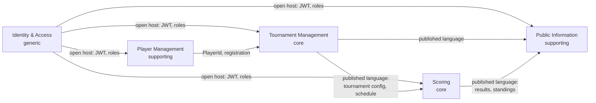

# Context map

Strategic design for RallyOn: which bounded contexts exist, who owns what, and how contexts may talk to each other. Status: **draft**. Rows marked _proposed_ are not implemented and need an ADR before code depends on them.

Sources: `docs/wiki/Architecture/Modules.md` (intended modules), `docs/adr/0001-use-spring-modulith.md`, the module layout in `service/tournamentmgmt`, and `docs/wiki/Personas.md`.

## Contexts

| Context | Type (subdomain) | Primary persona | Status in code |
| --- | --- | --- | --- |
| Tournament Management | Core | Organizer | `service/tournamentmgmt`; modules `setup.configuration` (implemented), `setup.rules`, `setup.phases` (API stubs), `planning`, `administration` (empty `package-info` only) |
| Scoring (Ergebnisdienst) | Core | Organizer | Placeholder `service/scoring`; today scoring _rules_ live in `setup.rules` |
| Player Management | Supporting | Player | Placeholder `service/playermgmt`; today participants live in `setup.configuration` rosters |
| Public Information | Supporting | Spectator, Player | Not started; wiki says read-model only, no primary persistence |
| Identity & Access | Generic | all | Keycloak + `3rd_party/iam`; claim `rallyon_user_id`, roles `rallyon-organizer`, `rallyon-participants`, `rallyon-audience`, `rallyon-service` |

Why these types: scheduling, bracket formats and result calculation (Buchholz, tie-breaks) are what differentiates RallyOn, so they are core and deserve the richest domain model. Player records, public displays and authentication are necessary but not differentiating; buy or keep them simple.

## Relationships

| Upstream → Downstream | Pattern (proposed) | What crosses the boundary | Rule |
| --- | --- | --- | --- |
| Identity → all | Open host service, conformist downstream | Validated JWT, roles, `rallyon_user_id` | Strict validation stays in `3rd_party/iam`; contexts never parse tokens themselves |
| Player Mgmt → Tournament Mgmt | Customer–supplier | `PlayerId`, registration status | Tournament Management stores the id and a snapshot needed for the draw, never the player aggregate |
| Tournament Mgmt → Scoring | Published language (events preferred) | Tournament format, scoring rules, tie-break rules, fixtures | Scoring does not read Tournament Management tables |
| Tournament Mgmt / Scoring → Public Info | Published language, read model | Schedule, live scores, standings | Public Information owns its read model; no write path back |

Open decision: events (Spring Modulith application events inside one deployable, a broker between services) versus synchronous APIs. Until that is decided by ADR, keep integration behind each context's `api` package so the transport can change.

## Apps versus contexts

- An **app** is a UI shell for one persona. A **context** is a business capability with its own model. They are intentionally not one-to-one: the Organizer app uses Tournament Management and Scoring; the Player app uses Player Management and Public Information.
- Domain logic lives in the context services, not in apps, so two apps never duplicate a rule.
- A backend-for-frontend per app is _proposed_ only if composing several contexts in the client proves painful; it needs an ADR.

## Observations about the current code

- `setup.configuration` is a deployable-sized chunk of Tournament Management: it owns the tournament, disciplines, brackets, courts, venue, participants and registration. Participants and rosters will likely move to Player Management and registration policy stays with Tournament Management; plan that split before building registration features.
- `Tournament` in `setup.configuration.api` remains a wide nullable published DTO. ADR 0003 separates draft domain snapshots and pure use cases from that contract; aggregate ownership is unchanged. See `docs/architecture/tactical-design.md` for current implementation and remaining modelling decisions.
- `setup.rules` mixes Tournament Management configuration (seeding, court allocation) with Scoring concerns (scoring rules, tie-breaks). Decide which context owns each rule type before implementing `setup.phases` or a scoring service.
- Several rule types carry `TODO(review)` markers (seeding rating source, court allocation fairness, match duration); these are domain decisions the refinement step should surface, not implementation details.

## Maintaining this map

- A change that introduces a new context, a new cross-context dependency or moves a concept between contexts updates this file and, if architecturally significant, adds an ADR.
- Specs under `openspec/` name the owning context in their proposal (see `openspec/config.yaml`).
