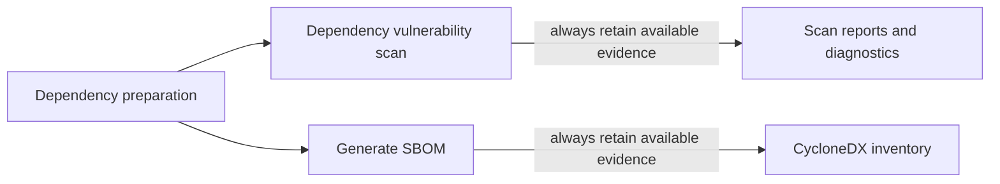

# Design: issue #187 PR 1 dependency security pipeline

## Context and approved delivery boundary

The owning context is repository delivery/tooling. This change alters no aggregates, domain invariants, published application ports or business events. It adds one CI behavior capability while keeping existing application specifications untouched. The approved whole-issue plan has two PRs; this design implements only dependency remediation, scanner execution and independent SBOM evidence. PR 2 retains the all-workflow, CodeQL, Docker and release work. No new issue is assumed; task decomposition and any exact issue payload are prepared only after G2 and independent G3.

## Existing evidence and current uncertainty

The baseline report at main a5834c7 contains 141 dependencies and 13 report entries with findings; raw package/CPE/CVE records and source/report hashes are in [baseline evidence](evidence/baseline-findings.json). Known candidates for product mismatch include our own dev.wlambertz.rallyon.iam:keycloak-core versus Keycloak server, Micrometer's registry versus the Prometheus server, and overly broad historical Spring matches. These are triage candidates, not pre-approved waivers. PostgreSQL's [vendor advisory](https://github.com/pgjdbc/pgjdbc/security/advisories/GHSA-j92g-9f8w-j867) establishes that the baseline driver 42.7.11 is in an affected range with a fix from 42.7.12. Final disposition of every baseline finding remains implementation/independent-check evidence; this planning package does not claim that target upgrades already produce a green scan.

## Dependency decisions and compatibility

Use Boot parent 4.1.2 in the service and shared IAM starter together, preserving the platform's BOM-managed dependency families. The published BOM supplies Framework 7.0.10, Security 7.1.2, Tomcat 11.0.27 and PostgreSQL JDBC 42.7.14. Override the Kotlin version consistently to 2.4.21 so compiler, stdlib, reflect, kapt, all-open and no-arg/JPA tooling do not drift. Manage the already-present org.webjars:swagger-ui transitive dependency explicitly at 5.34.1; do not upgrade Springdoc's feature line merely to change the embedded sanitizer. Inspect the resolved graph and packaged resources rather than trusting version properties alone.

**Human review flag:** changing 3rd_party/iam/keycloak-spring-starter dependency metadata affects shared platform consumers. G2 explicitly includes that change. IAM runtime policy/source is not changed to accommodate dependency upgrades. Add focused tests using generated test keys and a local fake JWKS provider to verify the configured decoder's valid-token and bad signature/issuer/audience/expiry paths, plus existing strict role/user-ID principal behavior. These are automated isolated tests, not live Keycloak requests. If a public contract or policy must change, return to scope/specification approval rather than weaken checks.

There are no new product runtime libraries, modules, DB migrations, REST/JWT/ro signatures, frontend decisions or Java-container/runtime changes. Python standard-library test/validation scripts and a pinned developer Actionlint executable do not alter product dependencies. A new ADR is not needed: existing architectural boundaries remain intact and the CI trust/operation tradeoffs are documented here and in nearby operational guidance.

## Pipeline and evidence flow

Preserve .github/workflows/security-scan.yaml and its current push-main / PR-main / weekly schedule triggers. Retain Dependency vulnerability scan and Generate SBOM names. Add a read-only dependency-preparation job that checks out the run's exact revision without persisted Git credentials, installs shared IAM, resolves runtime JARs and uploads the dependency input inventory/artifact. Both downstream jobs require successful preparation and use the same revision. Scan input remains JARs, including analyzable embedded JavaScript; no manifest-only substitution.

The scanner job downloads that run's prepared input and invokes the official container at the [verified OCI digest](evidence/scanner-image.md), not the wrapper Action's latest image. It mounts only inputs/suppressions read-only plus writable scanner data/report directories; it does not expose the full workspace, Git credentials or Docker socket inside the container. The image supplies its own Java; host JAVA_HOME is not injected into it. Changed checkout/setup/cache/artifact Actions use complete verified commit SHAs. Local scanner tests replace Docker with a fake executable; actual cold/warm scanner runs and GitHub outcomes are recorded separately.

The SBOM job is a sibling of the scanner, not its dependent. It checks out the same revision, installs the same IAM metadata and runs the existing pinned CycloneDX Maven plugin 2.9.1 for the service. Its inventory is compared with prepared dependency coordinates; it may resolve its graph again but cannot use another revision or floating runtime dependency versions. Preparation failure blocks both downstream jobs; scanner findings or execution failure do not block the SBOM job. Generated evidence uploads use always-run conditions, without allowing a failed scan step to become successful.

## Failure and suppression policy

Keep --failOnCVSS 7 and scanner analyzers active. Do not introduce continue-on-error, threshold lowering, output filtering, broad artifact exclusions or feature-unreachable waivers for genuine affected components. Wrapper/logging code preserves nonzero exit status, including a blocking finding and image/feed/network failures. A missing report after infrastructure failure is marked unavailable, never interpreted as no findings. Engine-generated HTML/JSON reports are retained for vulnerability-gate failures; diagnostic metadata and available logs remain useful when the engine cannot create its reports.

Store a source-linked disposition per baseline entry/CVE, including exact package identity and primary affected-version evidence. Only proven erroneous product/version applicability may receive a narrow suppression in .github/dependency-check-suppressions.xml. Each rule targets the canonical package/version and specific incorrect CPE/CVE; where the engine has no package URL, use an exact version-bounded artifact identity with independently checked counterexamples. Keep the artifact, its transitive libraries and all unrelated matches in coverage. Rules need rationale/source and an explicit UTC expiry no more than 90 days ahead. A standard-library validator rejects missing, expired or overly distant expiry and unsafe/incomplete rule structure; unused rules are reported for cleanup. Do not auto-renew exceptions. Actual rule semantics and counterexamples are independently reviewed.

## Cache, secrets and execution limits

Data restoration is allowed on all events, but shared-cache saves and optional NVD_API_KEY are allowed only for push/schedule execution on the repository's actual default branch. PRs, including same-repository PRs, do not receive the key or invoke the shared save step. Cache identity includes scanner digest/version and data compatibility; updated data is written to a new trusted cache key rather than overwriting incompatible snapshots. No restore of caches produced by untrusted PR scope is used for trusted default-branch execution.

Data updates remain enabled. Compatible fresh cached data may follow the engine's normal freshness window; no unconditional --noupdate fallback or ignoring update exceptions. Without a trusted optional key, use the official NIST JSON 2 feed through `--nvdDatafeed https://nvd.nist.gov/feeds/json/cve/2.0/nvdcve-2.0-{0}.json.gz`. With a trusted optional key, retain NVD API operation. Select once before execution; a failure never switches modes. The scanner remains the approved official 13.0.0 image/digest and the job remains bounded to 60 minutes.

Before every keyless invocation, retrieve `https://nvd.nist.gov/feeds/json/cve/2.0/nvdcve-2.0-modified.meta` with at most three attempts, each with a 20-second timeout. Require one timezone-aware `lastModifiedDate`; reject missing/invalid/duplicate dates, age greater than 48 hours, or a timestamp more than five minutes in the future. Exactly 48 hours and exactly five future minutes remain valid. A required metadata retrieval/parse/freshness failure blocks scanning even with an existing cache. Record selected mode, metadata timestamp and SHA-256 of retrieved bytes in execution evidence; no key material is recorded. Use Python's standard library with injectable network/clock boundaries in tests.

NVD remains the automated primary source. BSI/CERT-Bund is supplementary manual context; no BSI adapter, scan engine, replacement policy or extra CI job is introduced. Manufacturer advisories remain primary affected/fixed-version evidence. The recorded 13.0.0 no-key API failure is historical failure evidence; actual feed cold/warm runs are still required before acceptance.

Pass any optional key only to the trusted scanner step, without shell tracing or command-value logging. Temporary credential configuration is outside cache/report input mounts, has restrictive permissions and is removed on success and failure; no key is persisted in the repo or artifacts. Fake-key tests check both logs and retained files. Default permissions are contents:read; the scanner/SBOM jobs gain no publication or security-event write privilege. Cancel superseded PR security runs, without applying cancellation to PR 2 publication jobs.

## Validation and acceptance matrix

| Requirement | Planned proof |
| --- | --- |
| SCA-001 | Effective dependency/plugin graph; IAM install/tests; backend clean verify; isolated real-decoder/strict-principal regression tests; existing API/architecture tests |
| SCA-002 | Image/version evidence; runtime-JAR and embedded-JavaScript reports; Actionlint; exact input/revision identity |
| SCA-003 | Fake Docker blocking and infrastructure failures preserve nonzero status; actual scanner exit/report evidence; no ignored errors |
| SCA-004 | All baseline dispositions; expiry/boundary and narrow-match counterexample fixtures; independent review of each active rule |
| SCA-005 | Cold/warm executions; fork/same-repo-PR/default-push/schedule trust fixtures; keyless path and fake-key non-disclosure/cleanup checks |
| SCA-006 | Actionlint/job-graph review; real sibling SBOM success; simulated scan failure keeps reports/SBOM available while scan stays red; preparation failure blocks downstream jobs |
| SCA-007 | Fresh G5/G6 checkers, three G7 lenses, maintainer report/CI walkthrough G8 and separate merge approval |

Expected commands after implementation: IAM Maven install/test, service clean verify, Go go test ./..., lifecycle/helper/hook/readiness Python suites, python3 -m unittest discover -s tools/scripts/tests -p 'test_security*.py' -v for scanner/expiry fixtures, pinned Actionlint, OpenSpec 1.14.2 schema/spec validation, npm run format:check, link checks and git diff --check. Existing dependency tools may create local caches; tests must not publish tags, releases or registry images or request real Keycloak tokens. Local fake-process tests do not emulate GitHub's scheduler; actual workflow/job/artifact observation is mandatory evidence. Post-implementation verification/review/UAT artifacts are not created during this proposal.

## Rollout and recovery

Deliver PR 1 with exact artifact hashes, independent checks, actual cold/warm evidence and all remaining findings visible. Genuine unresolved CVSS >= 7 findings block acceptance; ambiguous applicability returns for review. Human G8 reviews the before/after finding inventory, negative cases, cache/secret boundaries and real scan/SBOM outcomes. Merge is a separate decision. Revert the reviewed changes normally if required; never recover by disabling the gate or weakening auth. Keep #187 open for PR 2 and the final observed green main/Docker workflow. The original approved refinement and supplied plan remain unchanged.
